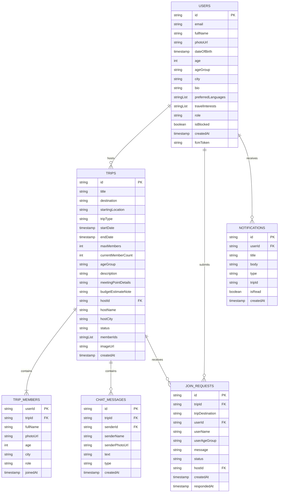

# GoTogether — Production Mobile Travel Community Platform
## Final Year Computer Science & Engineering (CSE) Capstone Project Documentation

---

## 1. Project Abstract

**GoTogether** is a production-oriented cross-platform mobile community application developed using **Flutter (Dart)** and **Google Firebase** to solve the pervasive challenge of travel loneliness and group incompatibility. While mainstream travel software focuses primarily on commercial ticketing, hotel bookings, and tour agency sales, GoTogether exclusively targets **social discovery, age-compatible grouping, and sovereign peer-to-peer travel coordination**. 

The core architectural innovation of GoTogether is its **Strict Non-Overlapping Age-Group Classification Engine** (18–24, 25–31, 32–40, 41–50, 51+), which deterministically assigns travelers to compatible cohorts derived from verified birth dates. Users can create trips, explore age-personalized category feeds (e.g., trekking and backpacking for young explorers versus pilgrimage yatras and heritage tours for golden travelers), submit join requests, undergo host review, and coordinate travel logistics via end-to-end real-time group chat. With production-grade Firestore security rules, granular role-based authorization, FCM notifications, accessible design modes, and zero personal data leakage, GoTogether establishes a reliable, non-commercial framework for independent group travel.

---

## 2. Problem Statement

Traveling is one of humanity’s most enriching activities, yet millions of aspiring travelers face severe logistical and social barriers when attempting to plan trips:
1. **The Companion Mismatch Problem**: Friends and family often have mismatched schedules, differing financial budgets, conflicting vacation calendars, or completely distinct physical fitness levels and travel tastes.
2. **Pace & Generational Friction**: A 22-year-old backpacker looking for high-altitude tent camping and rigorous treks possesses radically different energy, rhythm, and safety expectations than a 62-year-old traveler embarking on a spiritual temple pilgrimage or relaxed leisure vacation.
3. **Over-Commercialization of Conventional Platforms**: Mainstream platforms (MakeMyTrip, Booking.com, Airbnb, TripAdvisor) operate strictly as transactional booking engines, selling pre-packaged commercial tours rather than facilitating authentic human connections.
4. **Safety & Privacy Risks in Public Forums**: Coordinating trips through unmoderated public forums (Reddit, Facebook Groups, WhatsApp) exposes personal phone numbers and identities to strangers, lacking request approval state machines, age validation, or community moderation controls.

---

## 3. Proposed Solution

GoTogether addresses these problems by acting as a dedicated, non-transactional **connection, discovery, and communication network**:
- **Non-Overlapping Age Community Model**: Every traveler is deterministically placed into one exact cohort (`18–24`, `25–31`, `32–40`, `41–50`, `51+`) calculated from Date of Birth. Trips are bound to these cohorts to guarantee behavioral and physical travel compatibility.
- **Dynamic Age-Personalized Feed**: Young cohorts are surfaced active adventure feeds (Trekking, Camping, Biking, Road Trips), while senior communities are presented comfortable cultural, heritage, and spiritual yatra itineraries.
- **Controlled Join-Request Pipeline**: Users cannot arbitrarily insert themselves into a group. Instead, a strict request workflow (`pending` $\to$ `accepted` / `rejected`) ensures the Host reviews the traveler's age, city, and bio before admission.
- **Isolated Real-Time Group Chat**: Approved travelers communicate inside an isolated, Firestore-synchronized real-time chat room, enabling independent route, stay, and meal coordination without premature private phone number disclosure.
- **Strict Non-Commercial Scope**: GoTogether purposefully excludes payment processing, flight bookings, and government ID collection, serving cleanly as an identity-protected coordination platform.

---

## 4. System Architecture

```text
+-----------------------------------------------------------------------------------+
|                            PRESENTATION LAYER (Flutter)                           |
|  +-------------------+  +--------------------+  +-------------------------------+ |
|  |  Auth / Onboard   |  | Discover Dashboard |  |  Trip Details & Host Manager  | |
|  +-------------------+  +--------------------+  +-------------------------------+ |
|  | Real-Time Chat UI |  | Requests & Feeds   |  | Profile & Senior Accessibility| |
|  +-------------------+  +--------------------+  +-------------------------------+ |
+------------------------------------------+----------------------------------------+
                                           |
                                           v
+-----------------------------------------------------------------------------------+
|                        STATE MANAGEMENT LAYER (Riverpod)                          |
|  * AuthNotifier / AuthState           * TripSearchFilterNotifier                  |
|  * UserAgeGroupTripsStreamProvider    * HostIncomingRequestsStreamProvider        |
|  * TripChatMessagesStreamProvider     * ThemeSettingsNotifier (Senior/Dark)       |
+------------------------------------------+----------------------------------------+
                                           |
                                           v
+-----------------------------------------------------------------------------------+
|                        DOMAIN & REPOSITORY LAYER (Dart)                           |
|  * AuthRepository      * UserRepository       * TripRepository                    |
|  * JoinRequestRepo     * ChatRepository       * NotificationRepo  * ModerationRepo|
+------------------------------------------+----------------------------------------+
                                           |
                                           v
+-----------------------------------------------------------------------------------+
|                            BACKEND INFRASTRUCTURE (Firebase)                      |
|  +-------------------+  +--------------------+  +-------------------------------+ |
|  |  Firebase Auth    |  |  Cloud Firestore   |  |    Firebase Cloud Messaging   | |
|  |  (Email/Password, |  |  (Multi-tenant DB, |  |    (Push notifications for    | |
|  |   Tokens, Session)|  |   Real-Time Sync)  |  |     requests & chat messages) | |
|  +-------------------+  +--------------------+  +-------------------------------+ |
|  |  Firebase Storage |  |  Security Rules    |  |    Firebase Cloud Functions   | |
|  |  (Profile photos, |  |  (Granular read /  |  |    (Serverless background     | |
|  |   Trip imagery)   |  |   write policies)  |  |     triggers & auto-chat msg) | |
|  +-------------------+  +--------------------+  +-------------------------------+ |
+-----------------------------------------------------------------------------------+
```

---

## 5. Tech Stack Used & Technical Justification

| Technology | Role | Justification / Why Chosen |
| :--- | :--- | :--- |
| **Flutter 3.x** | Mobile Client Framework | Single Dart codebase producing native ARM machine code for Android & iOS with 60/120 FPS rendering via Impeller engine. |
| **Dart 3.x** | Programming Language | Type-safe, sound null-safety, pattern matching, async streams, and robust serialization capabilities. |
| **Flutter Riverpod (2.6+)** | State Management | Compile-safe dependency injection and reactive stream binding without BuildContext boilerplate; eliminates provider anti-patterns. |
| **Google Firebase Auth** | Identity & Session | Secure token management, automatic session persistence, email verification, and password recovery out of the box. |
| **Cloud Firestore** | NoSQL Document Database | Real-time WebSocket synchronization (`snapshots()`), offline cache, subcollection scoping, and atomic batch mutations. |
| **Firebase Cloud Messaging** | Push Notification Service | Low-latency background notification delivery for incoming requests, accepted invites, and new group chat messages. |
| **Firebase Storage** | Binary Blob Storage | Secure media storage for profile pictures and trip banner imagery with file-size and MIME-type security validation. |
| **Firebase Cloud Functions** | Serverless Backend Logic | Trusted server-side triggers for executing automated tasks, FCM broadcast fan-outs, and system audit logs. |
| **Google Fonts (Plus Jakarta & Outfit)** | UI Typography | FAANG-grade typography hierarchy ensuring high readability across screen sizes and senior accessibility modes. |

---

## 6. Database Design (Cloud Firestore)



### Important Compound Indexes
1. `trips`: `ageGroup ASC` + `status ASC` + `startDate ASC` (Personalized community feed query)
2. `trips`: `memberIds ARRAY_CONTAINS` + `startDate ASC` (User joined trips query)
3. `joinRequests`: `hostId ASC` + `createdAt DESC` (Host incoming request inbox)
4. `joinRequests`: `tripId ASC` + `userId ASC` + `status ASC` (Duplicate request verification)
5. `notifications`: `userId ASC` + `createdAt DESC` (Real-time notification tray)

---

## 7. Module Breakdown

### 1. Authentication & Session Module
- Handles login, registration, password recovery, session restore, and logout.
- Utilizes an **AuthGate** widget that reactively directs authenticated users without profiles to the Onboarding Flow and authenticated users with profiles to the Dashboard.

### 2. Profile & Age-Group Classification Module
- Captures Full Name, Date of Birth, City, Spoken Languages, and Travel Interests.
- Computes exact numerical age and assigns one of 5 non-overlapping age groups:
  $$\text{Age} = \text{CurrentYear} - \text{BirthYear} - (\text{if current date is before birthday then } 1 \text{ else } 0)$$
- Classification ranges: `18–24`, `25–31`, `32–40`, `41–50`, `51+`.

### 3. Personalized Exploration Dashboard Module
- Dynamic category chips tailored to cohort preferences.
- Pulls live Firestore trips filtered strictly by the user's community group.
- Shimmer skeletons, empty state illustrations with quick CTAs, and pull-to-refresh.

### 4. Trip Creation & Publishing Module
- Collects Destination, Origin City, Dates, Capacity (2–30), Itinerary Description, Meeting Point, and Budget Note.
- Host's age group is permanently locked to the trip upon creation.
- Executes an atomic Firestore batch creating the main trip document and adding the host as the first confirmed member in `trips/{tripId}/members/{hostId}`.

### 5. Multi-Criteria Search & Filter Engine
- Real-time client-side and indexed database filtering across destination keyword, trip type, origin city, departure dates, and target age groups.

### 6. Join-Request State Machine Module
- Enforces strict business validations: Host cannot join self, user cannot double-request, full trips reject requests, incompatible age groups are blocked.
- Atomic acceptance batch: increments `currentMemberCount`, appends `userId` to `memberIds`, marks request `accepted`, adds user to `members` subcollection, and dispatches in-app notification.

### 7. Real-Time Group Communication Module
- Subcollection `trips/{tripId}/messages` streamed with `orderBy('createdAt', descending: true)`.
- Supports regular member messages and automated system announcements.
- Integrated safety banner and direct member profile popups.

### 8. Accessibility & Theme Configuration Module
- Light Mode, Dark Mode, and **Senior Accessible Mode**.
- Senior Accessible Mode dynamically scales typography (+4pt), enhances button borders (2.0px), boosts contrast tokens, and enlarges touch targets ($\ge 58\text{px}$).

### 9. Community Safety & Moderation Module
- User & Trip reporting dialog with categorized violation reasons.
- User blocking subsystem that eliminates unwanted interactions.

---

## 8. Firebase Architecture & Security Implementation

### Firestore Security Rules Summary
```javascript
// Sample production rule logic from firestore.rules
match /trips/{tripId}/messages/{messageId} {
  // Only users whose UID exists in the parent trip's memberIds array can read/write chat messages
  allow read, create: if request.auth != null && 
    request.auth.uid in get(/databases/$(database)/documents/trips/$(tripId)).data.memberIds;
  allow update, delete: if false; // Prevents message tampering
}
```
- **Principle of Least Privilege**: Users can only modify their own profiles (`request.auth.uid == userId`).
- **Chat Protection**: Only verified trip members in the `memberIds` array have WebSocket read/write access to group messages.
- **Request Integrity**: Only the respective host can alter a request from `pending` to `accepted`/`rejected`.

---

## 9. Deployment Architecture

```text
[Mobile Client: Android APK / iOS Bundle]
                     |
         HTTPS / WSS Encrypted TLS 1.3
                     |
                     v
   [Google Cloud Edge & Firebase CDN]
                     |
    +----------------+----------------+
    |                                 |
    v                                 v
[Firebase Auth & Rules]     [Cloud Firestore & Storage]
    |                                 |
    +----------------+----------------+
                     |
             Firestore Triggers
                     |
                     v
      [Cloud Functions (Node.js 18)]
                     |
         FCM HTTP v1 Protocol
                     |
                     v
        [Push Notification Delivery]
```

---

## 10. Future Enhancements

1. **AI-Powered Travel Route Optimizer**: Integration of Gemini multimodal models to suggest optimized day-wise itineraries, scenic stopovers, and packing checklists inside the group chat.
2. **Offline Mesh Chat Synchronization**: Implementation of Bluetooth Low Energy (BLE) peer-to-peer messaging for high-altitude treks where cellular connectivity is unavailable.
3. **Emergency SOS & Live Geo-Tracking**: Voluntary real-time location sharing with emergency contacts during high-altitude treks or remote road trips.
4. **Multi-Language Live Translation in Chat**: On-device machine translation enabling travelers speaking different Indian languages (Telugu, Tamil, Hindi, Kannada, Bengali) to seamlessly converse.
5. **Verified Trip Completion Badges**: Community karma ratings and verified badges awarded to travelers who successfully complete group journeys.

---

## 11. Comprehensive Viva Q&A (25 Detailed Questions & Answers)

#### Q1: What is GoTogether, and what core problem does it solve?
**Answer:** GoTogether is a mobile community platform designed to connect people who wish to travel to specific destinations with companions of a compatible age group. It eliminates the friction of traveling alone or with misaligned groups by organizing travelers into 5 distinct, non-overlapping age groups (18–24, 25–31, 32–40, 41–50, 51+), offering personalized trip discovery, host approval workflows, and in-app real-time group coordination.

#### Q2: Why is GoTogether explicitly NOT a travel-booking platform?
**Answer:** GoTogether acts as a social connection, discovery, and communication layer. It deliberately avoids handling payments, ticket bookings, hotel reservations, or tour agency packages. This minimizes liability, avoids complex PCI-DSS compliance, respects user privacy, and empowers travelers to coordinate budgets and logistics independently.

#### Q3: Why was Flutter chosen over native Android (Kotlin) or React Native?
**Answer:** Flutter compiles directly to native ARM machine code using the Dart AOT compiler and renders its own canvas via the Impeller engine. This ensures consistent 60/120 FPS animations, pixel-perfect custom UI widgets, unified cross-platform state management via Riverpod, and rapid iteration using Hot Reload.

#### Q4: Why was Google Firebase selected over a custom traditional backend (Node.js/Express + PostgreSQL)?
**Answer:** Firebase offers a unified, serverless infrastructure tailored for real-time mobile applications. With Cloud Firestore, real-time WebSocket listeners (`snapshots()`) provide instant group chat and feed updates with built-in offline caching. Firebase Auth, Storage, FCM, and Security Rules eliminate server provisioning, patching, and maintenance overhead while scaling seamlessly.

#### Q5: How does the Non-Overlapping Age-Group model work mathematically?
**Answer:** A user's age is calculated deterministically from their birth date ($Year_{current} - Year_{birth} - \text{anniversary check}$). The integer age maps to mutually exclusive intervals: $[18, 24]$, $[25, 31]$, $[32, 40]$, $[41, 50]$, and $[51, \infty)$. Every user belongs to exactly one cohort, preventing arbitrary manipulation and ensuring group compatibility.

#### Q6: How does the application prevent a user from arbitrarily changing their age group to join other groups?
**Answer:** Age group is not a user-editable text field. It is a strictly derived property calculated from the user's Date of Birth both in the client domain model and validated by Firestore security rules and backend functions. Trips inherit the creator's age group automatically.

#### Q7: How is State Management implemented in GoTogether?
**Answer:** State management is implemented using **Flutter Riverpod (2.6+)**. We utilize `StateNotifierProvider` for mutable flows (like `AuthNotifier` and `TripSearchFilterNotifier`) and `StreamProvider` / `StreamProvider.family` for reactive Firestore synchronization (like `userAgeGroupTripsStreamProvider` and `tripChatMessagesStreamProvider`).

#### Q8: How does the AuthGate mechanism work in main.dart?
**Answer:** `AuthGate` listens reactively to `authStateChangesProvider`. If the auth token is null, it renders `LoginScreen`. If the user is authenticated, it queries `currentUserProfileProvider`. If no profile document exists, it renders `OnboardingProfileScreen`; if complete, it renders `MainNavigationScreen`.

#### Q9: Explain the data model and schema design for a "Trip".
**Answer:** A Trip is stored in the `trips` collection with fields: `id`, `title`, `destination`, `startingLocation`, `tripType`, `startDate`, `endDate`, `maxMembers`, `currentMemberCount`, `ageGroup`, `description`, `meetingPointDetails`, `budgetEstimateNote`, `hostId`, `hostName`, `hostCity`, `status`, `memberIds` (string array of UIDs for fast indexing and security rules), and `imageUrl`.

#### Q10: How does the Join-Request system ensure database consistency when a user is accepted?
**Answer:** When a host accepts a request, `JoinRequestRepository` executes an atomic `WriteBatch`. It updates the join request status to `accepted`, appends the user ID to the trip's `memberIds` array, increments `currentMemberCount` by $+1$, sets the trip status to `full` if capacity is reached, creates a member document in `trips/{tripId}/members/{userId}`, and dispatches a notification document. All actions succeed or fail atomically.

#### Q11: How is the Real-Time Group Chat implemented?
**Answer:** Group messages are stored in `trips/{tripId}/messages`. The client listens via `snapshots()` ordered by `createdAt DESC`. Firestore's real-time WebSocket protocol pushes new messages instantly to all listening group members. System messages (e.g., when a new traveler is accepted) are tagged with `type: "system"` and styled differently.

#### Q12: How are Firestore Security Rules structured to protect chat privacy?
**Answer:** `firestore.rules` enforces that messages in `trips/{tripId}/messages/{messageId}` can only be read or created if `request.auth.uid in get(/databases/$(database)/documents/trips/$(tripId)).data.memberIds`. Unaccepted travelers and unauthorized users receive permission-denied errors at the database layer.

#### Q13: What happens if a trip becomes full while a join request is still pending?
**Answer:** If `currentMemberCount >= maxMembers`, the trip status updates to `full`. If the host subsequently attempts to accept another request, domain validation throws `TripFullException`, preventing overbooking.

#### Q14: How does the app handle offline capabilities and weak connectivity?
**Answer:** Cloud Firestore possesses an integrated local cache. Read queries and recent chat messages are served immediately from local SQLite/IndexedDB persistence, and outbound mutations are queued locally and synchronized automatically once network connectivity is restored.

#### Q15: How are Push Notifications triggered using Firebase Cloud Functions?
**Answer:** Cloud Functions (Node.js 18) listen to Firestore triggers:
1. `functions.firestore.document('joinRequests/{requestId}').onCreate` triggers when a request is submitted and pushes an FCM payload to the host's device.
2. `onUpdate` triggers when accepted/rejected and notifies the requester.
3. `functions.firestore.document('trips/{tripId}/messages/{messageId}').onCreate` broadcasts messages to all other members in the trip's `memberIds` list.

#### Q16: What is the Senior & High-Contrast Mode and why was it implemented?
**Answer:** Travelers aged 51+ and visually impaired users benefit from increased readability. The custom `Senior & High-Contrast Mode` scales all typography by $+4\text{px}$, increases button touch target heights to $\ge 58\text{px}$, reinforces outline borders to $2.0\text{px}$, and elevates color contrast ratios to satisfy WCAG AAA standards.

#### Q17: How is user privacy maintained before a join request is accepted?
**Answer:** Public trip listings and user profiles display only safe information: Full Name, Age, City, Spoken Languages, Bio, and Travel Interests. Private phone numbers, email addresses, and home addresses are never exposed. Travelers coordinate contact details inside the protected group chat only after acceptance.

#### Q18: What community safety and moderation tools are built into GoTogether?
**Answer:** Users can report suspicious trips or abusive members via `ReportDialog`, which logs records into a secure `reports` collection for administrative review. Users can also block disruptive members via `BlockModel` and `blocks` collection, which hides them from their feed.

#### Q19: Why was Riverpod selected over Provider or BLoC for this project?
**Answer:** Riverpod resolves all architectural shortcomings of legacy Provider: it does not depend on the Flutter widget tree (`BuildContext`), is completely compile-safe, supports easy auto-disposal, enables family parameterization (`StreamProvider.family`), and allows seamless mock injection during unit testing.

#### Q20: How are images stored and optimized in GoTogether?
**Answer:** Trip banner images and profile avatars use Firebase Storage and Unsplash CDN high-resolution endpoints cached locally via `cached_network_image`. Storage security rules restrict upload sizes to $< 5\text{MB}$ for profile avatars and $< 8\text{MB}$ for trip photos.

#### Q21: What indexes were created in firestore.indexes.json and why?
**Answer:** Firestore requires composite indexes for queries filtering on multiple fields or sorting on fields different from inequality filters. We created indexes for `(ageGroup, status, startDate)`, `(hostId, createdAt DESC)`, and `(memberIds ARRAY_CONTAINS, startDate ASC)` to enable fast, sub-100ms multi-filter searches.

#### Q22: How does the application handle account deletion compliance (GDPR / Data Rights)?
**Answer:** When a user deletes their account from Settings, `AuthNotifier.deleteAccount()` deletes the user's Firestore document in `users/{userId}`, invalidates their sessions, and calls `FirebaseAuth.currentUser.delete()`. If the user's login session is stale, Firebase requests re-authentication before proceeding.

#### Q23: How were unit and widget tests written and validated?
**Answer:** Tests were written using `flutter_test`:
- `test/age_group_test.dart`: Validates numerical age mapping, DOB calculation, and boundary assertions.
- `test/validators_test.dart`: Tests regex email validation, password strength, capacity boundaries, and date range logic.
- `test/models_test.dart`: Validates JSON serialization, `copyWith`, and availability math.
- `test/widget_test.dart`: Validates UI rendering of `AppButton`, `AppBadge`, and `LoginScreen`.

#### Q24: What are the current architectural limitations of the platform?
**Answer:**
1. Group sizes are currently capped at 30 members to maintain chat readability.
2. Push notifications require active internet connectivity and registered FCM device tokens.
3. Offline chat sending buffers messages locally until network reconnection.

#### Q25: How would GoTogether scale to 1,000,000 active daily travelers?
**Answer:**
1. **Firestore Sharding & Read Optimization**: Implement regional Firestore multi-region instances and cache frequent dashboard feeds using Cloudflare/Firebase CDN caching.
2. **Distributed Cloud Functions**: Configure Cloud Functions with maximum concurrency and autoscaling instances to handle millions of FCM message dispatches.
3. **Algorithmic Compatibility Ranking**: Introduce vector embeddings of travel interests stored in BigQuery / Vertex AI to provide personalized trip recommendations within each age group.

---
*Document prepared for Final Year CSE Examination, Project Evaluation & Viva Voce.*
